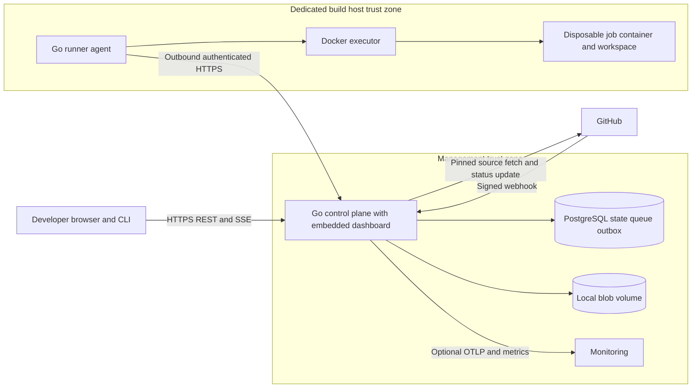

# System architecture

Status: proposed, pending architecture approval. Scope authority: [requirements](requirements.md). Detailed execution rules: [pipeline engine](pipeline-engine.md) and [runners](runners.md).

## Deployable units

Shipra begins as a modular monolith plus an independently deployed runner. `shipra-server` serves REST, the compiled dashboard, authenticated event streams and internal reconciliation loops. PostgreSQL owns state, queue and outbox. A local filesystem blob adapter stores source snapshots, logs and artifacts on a dedicated volume. `shipra-runner` executes only on dedicated Linux build machines; `shipra` is the CLI. No production command runs inside the control-plane process or its containers.

The bidirectional work exchange uses runner-initiated requests only. Jobs cannot access the runner management endpoint, its credential store, the Docker socket, the control-plane data network, or cloud metadata. Builds on the same machine as the control plane are a development convenience only and provide a weaker boundary; the release guide recommends a dedicated runner VM/host.

## Module ownership

| Requested component | v0.1 disposition and owned responsibility |
|---|---|
| API server, dashboard, CLI | API is one ingress layer; dashboard static assets served by server; CLI separate client |
| Authentication service | In-process identity/session/token and authorization module; external identity later |
| Pipeline engine/parser/DAG engine | Parser is pure bounded compiler; execution module persists the normalized graph and drives transitions |
| Scheduler/queue | Scheduler module reads durable ready jobs; queue is PostgreSQL tables/indexes, not a service |
| Runner manager | Registration, credentials, approved pools, capacity/lease accounting inside server |
| Runner/execution engine | Independent agent binary with Docker executor adapter; shell interpreter runs only inside job container |
| Artifact/log services | Modules authorize uploads, manifests, retention and reads through common blob interface |
| Secrets service | Policy and encrypted persistence inside server; decrypt only for authorized attempt grants |
| Git provider/webhooks | Built-in GitHub adapter, bounded ingestion, verification, source discovery and status outbox |
| Notifications | Core UI events and GitHub commit status initially; additional notification adapters later |
| Deployment engine/environment manager | Reserved domain boundary; introduced P9 with approvals and reconciliation |
| Plugin runtime | Absent initially; process-isolated adapters in P11 |
| Database/cache/object storage | PostgreSQL plus local blobs; memory may accelerate reads but cannot own durable decisions; no Redis |
| Observability stack | Instrumentation and export from start; Prometheus/Grafana/collector optional external operators' tools |

Modules call typed interfaces, not internal HTTP endpoints. Domain modules cannot import transport handlers or invoke executors. State transitions belong to execution/scheduler services; Git, UI and integrations request commands through those services. Credentials are addressed by opaque references; secrets do not enter normalized plans. Blob methods accept server-generated object identities rather than user paths.

## Durable command flow

1. Authenticated trigger ingestion records a unique trigger/inbox row before acknowledging delivery.
2. A bounded background worker fetches `shipra.yml` and a source archive at the immutable commit, validates repository and ref policy, and produces a configuration revision and source manifest.
3. Parse/validate into a normalized graph; admission transaction creates PipelineRun, JobRuns, dependency edges and initial events. Invalid configuration is a durable rejected trigger with diagnostic locations; no job gets scheduled.
4. Scheduler evaluates prerequisites and policy, atomically grants an eligible attempt with a fencing epoch and expiring lease. A runner receives it via long poll.
5. Runner prepares workspace, executes steps, uploads sequence-numbered logs and artifact chunks, and reports a fenced result. Server finalizes only validated data and state.
6. State updates and external-notification intents commit in one transaction. Outbox dispatch retries independently; unavailable GitHub does not change build success.
7. Reconcilers handle deadlines, lost leases, pending uploads, outbox delivery and garbage collection. Events and UI are derived views of committed state.

No global event-sourcing system is required. Current relational state plus append-only domain/audit records is sufficient. PostgreSQL transactions protect admission and assignment; a filesystem upload cannot join the database transaction, so object finalization uses a staged upload/manifest protocol and orphan sweeper.

## Evolution without speculative services

First scale agents horizontally; partition trust pools and control capacity. Replace local blob storage with shared S3-compatible storage before running multiple control planes. Then make schedulers/reconcilers cooperate through database locks and fencing, remove local session/stream assumptions, and measure contention. Only extract log ingest or integrations if independently measured CPU, I/O, failure isolation or ownership warrants it.

Redis is not needed for correctness; PostgreSQL notification hints can shorten polling but durable rows remain authoritative. PostgreSQL documents that `SKIP LOCKED` is useful for queue consumers but gives an inconsistent view unsuitable for general reads; Shipra still needs explicit fairness and transactions. [PostgreSQL SELECT](https://www.postgresql.org/docs/current/sql-select.html). Notifications are wake-up hints, not a durable job transport. [PostgreSQL NOTIFY](https://www.postgresql.org/docs/current/sql-notify.html).

Thousands of jobs eventually require measured log throughput, storage lifecycle, queue indexes, database connection limits, pagination, quotas and pool capacity. The initial design makes these visible; it does not guarantee they will scale without redesign.

## Boundaries that must survive refactoring

- Immutable input identities: repository ID, commit SHA, config digest, parser version, source digest, approved policy revision and resolved image digest.
- Tenant ownership on stored objects and authorization on every lookup, even though v0.1 has one workspace.
- Monotonic terminal results and per-attempt fencing; retry creates a new attempt, manual rerun creates a new run.
- No exactly-once external command claim. Unknown deployment outcomes require reconciliation.
- No uncontrolled executable extensions inside the core; no mandatory AI or Kubernetes dependency.

See [ADRs](architecture-decisions.md), [data model](data-model.md), and [security boundaries](threat-model.md).
