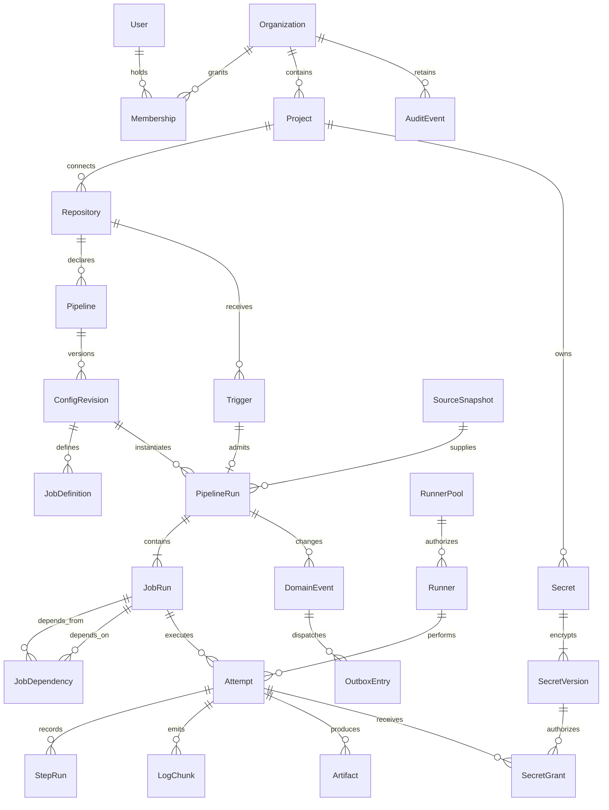
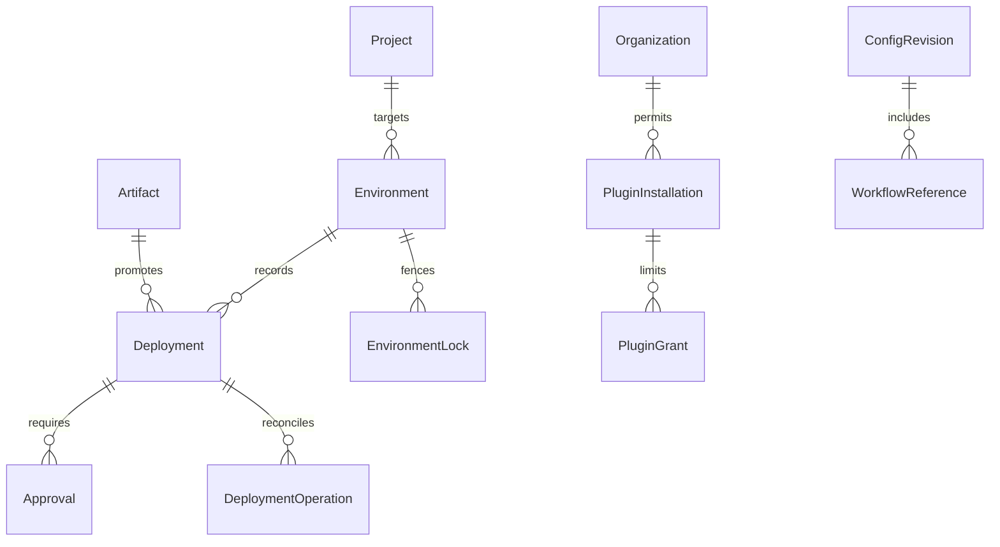

# Data architecture

Status: proposed conceptual model, not a migration or implemented schema. The SQL schema must enforce these relationships and invariants in P1-P4. Names are logical entities; table naming is an implementation detail.

## Entities and relationships

`Organization` is the workspace ownership boundary; v0.1 creates exactly one. `Membership` is a workspace admin/operator/viewer role, not an implicit project-wide secret grant. Project-level memberships arrive P8. Include organization ownership in keys and queries now; this does not make a single-host instance a safe hostile multi-tenant service.

| Entity | Key fields and meaning |
|---|---|
| User / Membership / Session / ApiToken | Opaque IDs, identity, role, active flag; salted password hash, hashed session/token value, expiry/revocation; never plaintext token storage |
| Project / Repository | Workspace ID, configured provider installation/repository ID, display name, trusted ref policy revision; names and clone URLs are not identity |
| Pipeline / ConfigRevision | Repository+config path; immutable source text blob, config digest, spec/compiler version, normalized plan, source locations, security policy reference |
| JobDefinition | Config revision, stable job key, dependency keys, execution/resource/secret references; versioned immutable plan fields may use bounded JSONB |
| Trigger | Provider delivery or manual request identity, verified payload metadata, requested ref/SHA, admitted/rejected state, diagnostics; rejected triggers can exist without a run |
| SourceSnapshot | Repository ID, exact commit SHA, archive digest, size, server-owned blob key, creation provenance; archive hash checks bytes, not builder trust |
| PipelineRun | Trigger, revision, source snapshot, actor, policy revision, state/version, deadline, reason, terminal timestamp, parent rerun ID |
| JobRun / JobDependency | Run+job key, readiness state, retry policy, next eligible time, current epoch/attempt, queue deadline; edges reference JobRuns in same PipelineRun |
| Attempt / StepRun | JobRun+attempt number, runner, assignment ID/epoch, lease expiry, timeouts, start/result sequence, input/image digests, exit/reason, resource reservation, stop-confirmation status |
| RunnerPool / Runner | Workspace, permitted projects/trust class, approved capabilities, capacity, token hash, credential generation, protocol range, heartbeat, draining/revoked flags |
| LogChunk / Artifact / Upload | Attempt+stream+sequence or artifact name; digest, byte range, size, content type, staging/finalized state, object key, expiry, integrity status |
| Secret / SecretVersion / SecretGrant | Project, policy, encrypted version, key ID, actor; grants bind version to authorized attempt and policy revision; no plaintext in metadata |
| DomainEvent / OutboxEntry | Aggregate+version, event ID, safe payload, destination, idempotency key, delivery attempt, next retry, acknowledgment/dead-letter status |
| AuditEvent | Actor/action, object, organization, request ID, time, authorization outcome, bounded redacted before/after metadata; append-only application privileges |
| IdempotencyRecord / EnrollmentToken | Principal+operation+key and payload hash, stored response/expiry; one-use enrollment digest with expiry/pool scope |

`Workflow` is the graph embodied by ConfigRevision in v0.1, not a redundant table. `Job` is JobDefinition; physical attempts are not overwrites of JobRun. Optional stage labels may be added later for presentation only. No EAV universal-object store.

## Future domain additions

These relationships are reserved domain concepts, not empty tables to create in P1. A deployment records artifact digest, environment revision, approvers, operation key and external desired/observed state. A plugin installation pins a verified package/API version and capabilities. CacheEntry later records producer trust scope, key/version, digest and expiry; it is never authoritative output provenance.

## Transactional invariants and indexes

- Scope foreign keys by organization/project as appropriate, and validate authorization before dereference. Unique repository identity per configured provider installation.
- Unique provider delivery `(provider, integration_id, delivery_id)` and manual `(principal, operation, idempotency_key)`; changing a reused key's body returns conflict. Keep a trigger-to-run uniqueness constraint.
- Unique `(pipeline_run_id, job_key)`, `(job_run_id, attempt_number)`, `(attempt_id, stream, sequence)` and `(attempt_id, artifact_name)`. Duplicate uploads with different digests conflict.
- At most one current nonterminal attempt per JobRun; state updates compare aggregate version plus current attempt and epoch. Terminal states are immutable. A retry adds an Attempt after the previous result is terminal and eligible.
- Reserve runner/project capacity and assign work in one transaction. Locking order is documented and tested to prevent deadlocks. Never hold row locks while fetching source, waiting on runners or uploading objects.
- Queue partial indexes cover eligible states, `next_eligible_at`, pool and project; lease expiry index supports reaping; run history uses project+created_at+ID keyset pagination. Keep run/attempt IDs out of metric labels.
- Domain state, audit event and outbox intent commit atomically for critical mutations. Events contain no raw credentials or complete user scripts by default.

Use DB time for server leases and UTC instants for storage. Runners use a conservative monotonic lease budget. Schema changes use explicit forward migrations, backed-up destructive changes and compatibility gates. Restoring a database from the past also requires credential/lease invalidation: do not reconnect stale agents and replay old assignments.

## Storage placement and lifecycle

| Store | Contents | Retention proposal |
|---|---|---|
| PostgreSQL | Identities, policies, plans, runs, manifests, log offsets, queue, events, audit | Run/plan metadata 90 days; audit 180 days; critical policies retained while referenced |
| Local blob volume initially | Source/config snapshots, redacted log chunks, artifacts, staged uploads | Logs/artifacts 30 days; snapshots while retained runs reference them; admin project quotas |
| Runner local disk | Disposable workspace, bounded encrypted/permission-restricted temporary grants and log spool | Delete after terminal acknowledgment/expiry; reconcile leftovers on restart |
| Memory cache | Small immutable plan/read cache, wake hints | Bounded TTL; correctness survives total loss |
| External telemetry | Operational logs, traces and metric time series | Operator policy; recommend shorter debug retention, no secret payloads |

Proposed dedupe retention: delivery IDs and manual idempotency records at least 7 days, with compact trigger identity retained with run metadata. A known redelivery still maps to its original trigger while that metadata remains; no permanent dedupe promise after retention. P5 must validate the provider retry/manual-redelivery window and document behavior after deletion.

Deletion is mark-and-sweep: mark expired/unreferenced metadata, revoke new reads, delete bytes idempotently, then remove metadata or retain a tombstone. Do not delete blobs referenced by active runs, completed manifests, retention pins or future deployments. Staged uploads expire after 24 hours by proposed policy. Check server-generated paths stay below the blob root; reject symlinks/path traversal.

Disk quotas and a high-water mark stop admission/uploads before exhausting the management host. A failed required artifact finalization fails its attempt; log truncation is explicit metadata, never silent. Local storage is a single point of failure: back up PostgreSQL, blob manifests/bytes and separate key material as a coordinated recovery set. See [reliability](reliability.md).
