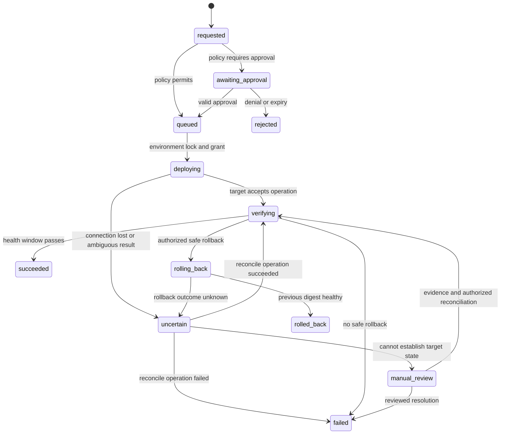

# Future deployment architecture

Status: proposed P9 design; absent from v0.1. Arbitrary shell steps can cause external effects, but that is not managed deployment, verified rollback or an approval boundary. Production credentials are outside v0.1 scope.

## Domain contract

Build once, promote a specific artifact digest. A Deployment binds project, environment revision, artifact and provenance, requesting actor, policy revision and idempotency key. Approval is a separate auditable record tied to that exact tuple. Changing artifact/environment/policy invalidates approval and requires evaluation again. Approval expiry and separation of author/approver become explicit policies, not a UI checkbox.

Only one active deployment owns a fenced environment lock by default. Deployment adapters issue operations with stable operation IDs and read observed external state after reconnect. The environment target must support an idempotency/reconciliation contract; absent one, ambiguous outcomes require operator review. Database fencing alone cannot stop a cloud provider operation already accepted.

Cancellation before target submission prevents dispatch. After submission, cancellation requests a stop or reconciliation; it cannot claim the external operation never happened. A timeout enters uncertain until provider evidence establishes the outcome. Deployment states are separate from build JobRun states.

## Strategies and integrations

Start P9 with one target and one declarative strategy in a sandbox environment; choose the target with the user before implementation. Later rolling, blue/green and canary strategies need health metrics, a bounded evaluation window, traffic control and fallback ownership. Rollback promotes a previously verified compatible artifact and configuration; it does not reverse database migrations or arbitrary data changes. Migration strategy and application/data compatibility are release prerequisites.

GitOps integration can open or update a desired-state change and observe an existing reconciler such as Argo CD. Shipra should record both Git approval and observed health and must not simultaneously command the same environment through conflicting deployment authorities. Whether Shipra itself reconciles or delegates is a per-target decision. The research differentiates this from CI execution. [Argo CD architecture](https://argo-cd.readthedocs.io/en/stable/operator-manual/architecture/).

Deployment notifications, history, target credential issuance and audit records flow through the existing outbox/policy/observability modules. Plugins may provide adapters later, but cannot approve their own actions or bypass environment locks. Secrets are issued only after final policy/approval checks and scoped to the target operation.

## Gate before production use

Prove duplicate submission is harmless or detected, an interrupted deployment reconciles, stale approvers cannot approve a changed artifact, policy revocation stops new operations, rollback has a tested health signal, and a human can resolve uncertainty from an audited runbook. External outages must not trigger blind re-execution. A rehearsed staging deployment and rollback/uncertainty drill are required before the first production environment.
