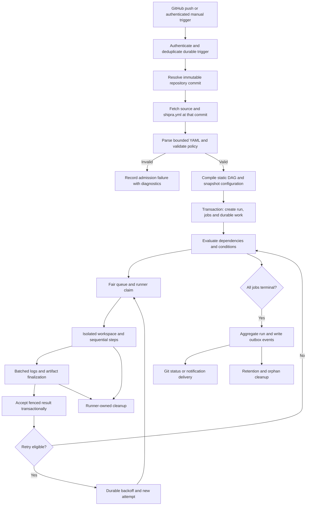
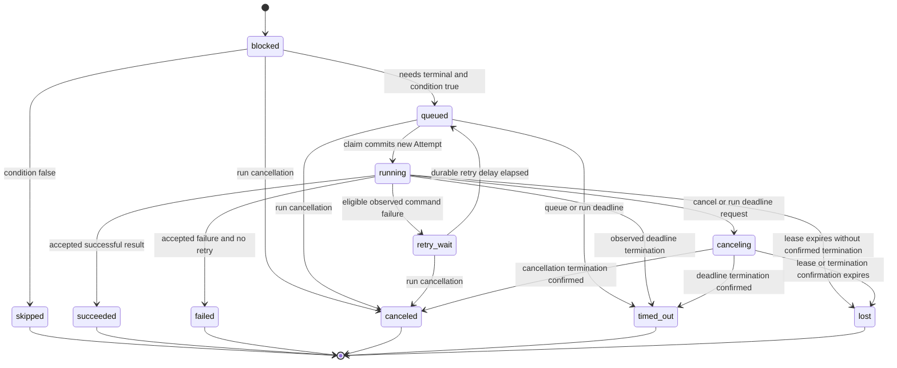
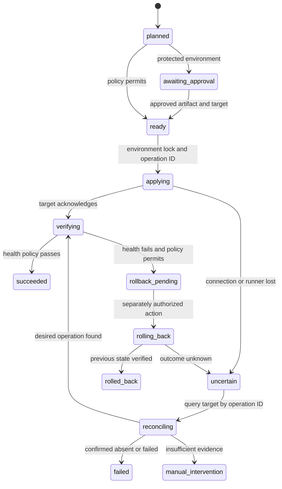

# Pipeline engine and execution semantics

Status: **Phase 0 proposal — awaiting architecture approval.** The deterministic engine is a module of the Go control plane. This document defines intended behavior, not an implemented guarantee. The language contract is [pipeline specification](pipeline-spec.md); physical execution is [runners](runners.md).

## Entities and ownership

| Term | Meaning and owner |
|---|---|
| Pipeline | Repository configuration identity, currently one `shipra.yml` per registered repository |
| PipelineVersion | Immutable raw configuration, parser/language versions, compiled DAG and digest at a commit |
| PipelineRun | One admitted trigger using a PipelineVersion and source commit, with immutable policy/secret-version references |
| Job | Static node definition in that PipelineVersion |
| JobRun | One logical node execution within a PipelineRun; owns dependency outcome, retry budget and current fencing epoch |
| Attempt | One physical runner assignment, with its own lease, deadline, container, logs, output manifests and result |
| Step | Ordered instruction inside one Attempt; its observations aid diagnosis but do not create a distributed queue |
| Workflow/stage | A conceptual future reusable workflow or visual grouping; neither is a separate executable entity in v0.1 |

There is at most one authorized active Attempt per JobRun. A failed Attempt may be followed by a new Attempt without making the JobRun terminal. Terminal JobRuns and Attempts never return to active state. A manual rerun creates a new PipelineRun with lineage to the previous run; it does not mutate old results. No code execution is exactly once: external effects can occur before a result is durably acknowledged.

The pipeline engine owns DAG eligibility, state transitions and aggregation; the scheduler owns fair allocation and durable queue claims; the runner manager owns agent identity, leases and cancellation delivery. They call internal interfaces and participate in short database transactions in one binary. No module infers success by parsing console logs.

## Admission and lifecycle

Before admission, a durable trigger record progresses through received, resolving, validated or rejected states. A missing configuration, invalid DAG, denied repository or unsupported version produces an admission failure linked to the trigger; it does not create a runnable JobRun. Provider fetch failures use bounded admission retries and then expose an admission error, never a fabricated build failure. A branch with no allowed push trigger is recorded as ignored. Snapshot bytes and source archive must be durably available before the transaction admits the run. Rejected/ignored trigger records remain auditable under retention policy.

GitHub webhook receipt acknowledges only after signature checks and durable inbox insertion. Delivery IDs deduplicate retries. Manual trigger requests use a project-scoped idempotency key plus canonical request hash. Same key/same request returns the original response; same key/different request conflicts. A deliberately new trigger for the same commit is allowed. The event identity, commit and request identity are distinct. GitHub documents delivery IDs and asynchronous webhook handling as practical controls. [GitHub webhook best practices](https://docs.github.com/en/webhooks/using-webhooks/best-practices-for-using-webhooks)

Source/configuration retrieval uses the registered GitHub repository and a fixed resolved commit. Mutable branch refs are never re-resolved during retry. The initial checkout helper extracts this stored source archive; it does not expose the GitHub integration credential to a build. Archives lack `.git`, submodule contents and Git LFS materialization in v0.1; workflows needing those features require later explicit support.

## JobRun state machine

The diagram shows principal transitions; the transition table below also covers deadlines on blocked/retrying jobs and failures during preparation. Root nodes are initially blocked and can become queued in the admission transaction. `running` at JobRun level means an active physical assignment; the Attempt records whether execution is preparing, actually running, or uploading. Reasons distinguish queue timeout, command failure, image-pull failure, resource exhaustion, artifact failure, permission revocation and infrastructure loss.

| Event | Required transaction and outcome |
|---|---|
| All direct needs terminal | Evaluate the frozen condition; queue or skip exactly once, with event and reason |
| Claim | Lock eligible job and runner capacity; recheck run cancellation/deadline; allocate Attempt ID and increment fencing epoch; reserve resources; record lease and emit assignment |
| Known preparation/helper failure | Attempt `failed`; JobRun `failed`, unless the retry policy explicitly permits that class in a future language version |
| Observed nonzero command result | Attempt `failed`; JobRun `retry_wait` if its retry budget remains and run is still active; otherwise `failed` |
| Success | Require all selected required outputs committed, all steps accounted for and valid lease/epoch; Attempt and JobRun `succeeded` |
| Attempt command deadline | Ask agent to terminate; confirmed stop gives Attempt/JobRun `timed_out`; unconfirmed stop gives `lost` with deadline reason |
| Queue wait deadline | Unassigned queued JobRun becomes `timed_out`, reason `queue_timeout`, without an Attempt |
| Run deadline | Atomically stop admission of new work; blocked/queued/retry_wait jobs become `timed_out`; active jobs enter `canceling` with timeout reason |
| Run cancellation | Atomically freeze new work; blocked/queued/retry_wait jobs become `canceled`; active jobs enter `canceling` |
| Lease loss | Active Attempt becomes `lost`; JobRun becomes `lost`; no automatic retry, even if retry budget remains |

`blocked` jobs do not consume the queue-wait budget; the pipeline admission deadline bounds that wait. `retry_wait` is bounded by the run deadline; each new queued interval receives its own bounded queue deadline. A required output failure, missing input artifact, OOM, image pull error, secret revocation, timeout, cancellation or lost lease is not an automatic retry candidate in v0.1. The narrow retry class prevents hidden repeated side effects after ambiguous infrastructure failure.

## Attempt state and terminal evidence

An Attempt progresses `assigned -> preparing -> running -> uploading -> succeeded|failed`. `assigned` starts at claim commit. Preparation includes image resolution/pull, workspace, source/input retrieval and policy-authorized secret acquisition. `uploading` begins only after command execution stops; it does not allow starting new commands. Preparation can fail directly without reaching `running`. A failure latch can exist while cleanup commands execute in `running`; only the final accepted result makes the Attempt terminal.

Every active state can enter `canceling` because of cancellation or timeout; confirmed termination results in `canceled` or `timed_out` according to the persisted stop reason. Any active state can become `lost` after lease expiry or unconfirmed process termination. A known failure need not pass through `uploading` if no selected outputs exist. A process exiting zero is not sufficient evidence of success until the server commits the final result and required artifact manifests.

`lost` means Shipra cannot establish the final execution outcome. The physical process may have stopped, continued or applied an external side effect. A late runner cannot rewrite `lost` as success. It may append a separately audited late observation and cleanup confirmation to improve diagnosis, without changing the terminal outcome or releasing its artifacts for dependency consumption. This is intentional honesty about uncertainty.

Result acceptance compares Attempt ID, assigned runner ID, current job epoch, current lease, active state and event sequence in one transaction. It writes result, job outcome/retry decision, dependency work, audit events and outbox records atomically. Duplicate requests with an identical idempotency key and body return the committed response even after lease expiry; a previously unseen late mutation is rejected. Outbox replay can redeliver observations but cannot repeat an accepted state transition.

## Parallelism and retries

Jobs with no unsatisfied dependencies may run concurrently up to project, pipeline, runner and resource limits. A runner executes the ordered steps of a job sequentially. Shared filesystem state exists only within an Attempt. Artifact inputs are immutable references to a successful producer's final Attempt in the same run; there is no implicit shared workspace or cache.

The default retry count is zero. Explicit `retries: 1` allows two physical attempts total, `retries: 2` allows three. After an eligible failure, retry delay is 5 seconds then 15 seconds, with server-generated jitter up to 20% recorded durably. A retry uses a new Attempt ID, fresh workspace/container, higher epoch and the same config, source commit and still-authorized secret versions. There is no retry of a single shell step and no automatic reuse of partial outputs.

The failed Attempt remains visible while the logical JobRun waits. Downstream conditions see only the JobRun's final outcome after the retry decision; they cannot race a failure that will be retried. Setting retries authorizes repeating the complete job and is appropriate only when the author can tolerate repeated side effects. Protocol retries merely retransmit one request and do not consume this budget.

## Run status, cancellation and races

PipelineRun states are `queued`, `running`, `canceling`, `succeeded`, `failed`, `canceled`, `timed_out`. The first committed job assignment moves queued to running. Terminal aggregation waits until every JobRun is terminal. Without a persisted run stop intent, any failed, lost, timed-out or canceled JobRun makes the run failed; otherwise succeeded and skipped jobs yield run success. A valid graph must have an executable root; a pipeline consisting solely of skipped jobs is not admissible under version 1.

An accepted explicit cancellation or pipeline deadline sets a durable stop intent and prevents new claims immediately. The first committed stop intent wins if cancellation and deadline race. When all jobs become terminal, that stop intent determines PipelineRun `canceled` or `timed_out`; `termination_unconfirmed: true` is also recorded if any Attempt is lost. This makes user intent visible without claiming all processes stopped. Individual timed-out jobs yield an overall failed run unless the pipeline's own deadline fired.

If a successful result transaction wins before cancellation, that JobRun remains succeeded. If the whole run was already terminal, cancellation returns its existing state and changes nothing. If cancellation commits first, subsequent success from an active Attempt is rejected; an acknowledgment that its process has stopped can still complete cancellation. Epoch/lease checks always apply. No terminal result is overwritten to make the UI look cleaner.

Default deadlines, clock handling and stop escalation are centralized in [runners](runners.md). An unresponsive agent never leaves a run canceling forever: the reaper closes its expired Attempt as lost, and run aggregation completes with the unconfirmed marker. Resource reservations are released durably, while that runner slot stays quarantined until cleanup is confirmed; a compromised/offline machine is an operator concern, not evidence of successful cancellation.

## Deployment boundary and later evolution

v0.1 has no deployment job type, production environment credential model, approvals, rollout controller or rollback guarantee. Trusted shell code can technically call external services; Shipra cannot infer or reconcile those effects. Documentation and UI must not present such commands as managed deployments.

A later deployment engine must introduce a distinct Deployment operation with environment locking, immutable artifact identity, authorization/approval binding, target operation ID and observed-state reconciliation. In particular, runner disconnection after submitting a change yields **uncertain**, not an automatic retry. The future intended lifecycle is:

Rollback is a second external operation and can fail; it is never a transaction undo. These states are future design constraints, not accepted v0.1 configuration or an implemented deployment engine.

## Required correctness evidence before implementation acceptance

Model and integration tests must cover cycles, missing dependencies, a diamond DAG, retries followed by success, failure handlers after skipped dependencies, duplicate results, stale epochs, cancellation racing a claim/result, run versus job deadlines, missing required artifacts and lost agents. A restarted engine must reconstruct identical eligibility and terminal status solely from PostgreSQL plus immutable blobs. No scenario may rely on in-memory timers, log text or an active dashboard connection for progress.
