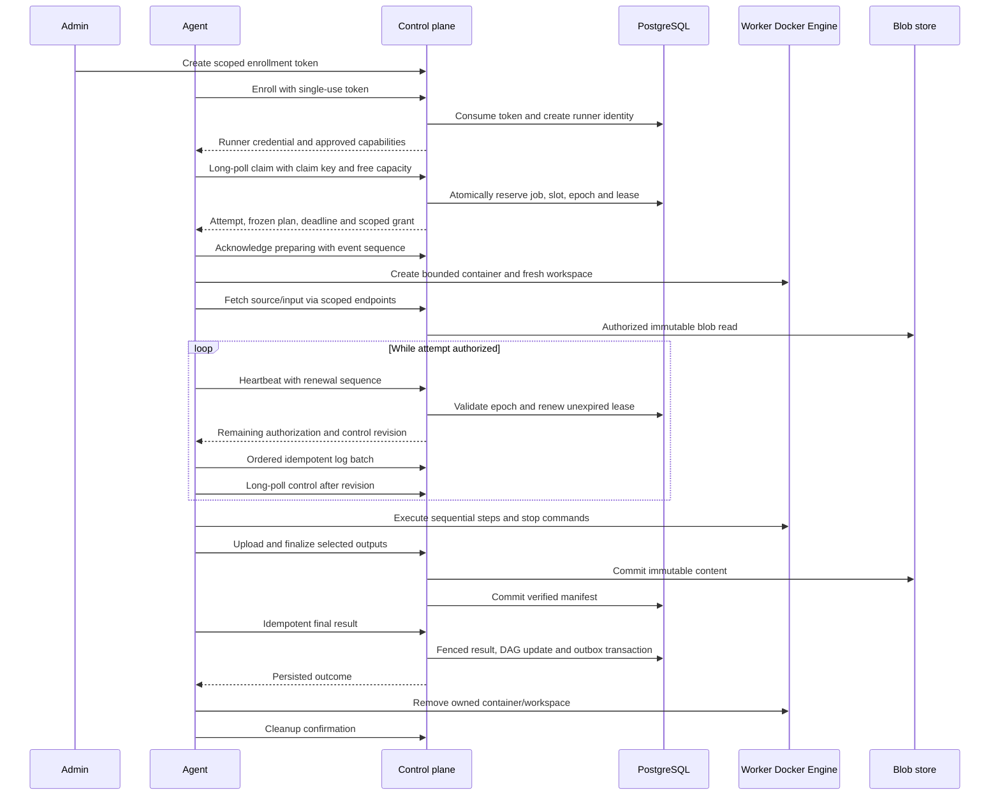

# Runner architecture and protocol

Status: **Phase 0 proposal — awaiting architecture approval.** All limits below are initial design values, not measured service guarantees. The first supported executor is a Linux agent controlling Docker Engine on its own worker host. The control plane does not execute repository commands.

## Executor decisions

| Model | Decision | Reason and boundary |
|---|---|---|
| Local process on control-plane host | Excluded from v0.1 | Couples arbitrary build code to service credentials, storage and availability |
| Linux Docker worker | v0.1 | Familiar image ecosystem and explicit resource controls; one agent per dedicated host/VM, fresh container and workspace per Attempt |
| Remote machine | v0.1 through installed agent | Agent makes outbound connections; no controller SSH or inbound runner port is required |
| Ephemeral worker VM | Later | Host teardown improves cleanup and trust separation but needs cloud provisioning, bootstrapping and capacity management |
| Kubernetes executor | Later | Useful pod lifecycle and capacity primitives; introduces cluster policy and scheduling dependencies that one developer does not initially need |
| Autoscaling pools | Later | Requires reliable demand metrics, drain behavior, budget limits and trusted ephemeral enrollment first |
| Windows/macOS or non-Docker executor | Later | Different process, filesystem and isolation semantics need a separate qualified executor contract |

Docker provides namespaces and resource-control mechanisms, but its daemon and host remain a significant security boundary. Shipra must not market shared-kernel containers as a sufficient hostile multi-tenant sandbox. Dedicated trusted-repository worker hosts are the v0.1 operating scope. [Docker Engine security](https://docs.docker.com/engine/security/)

## Agent identity and enrollment

An authenticated administrator creates a single-use enrollment token, scoped to a runner pool/project policy, with a proposed ten-minute expiry. Enrollment over TLS exchanges it once for a random runner credential. Both enrollment and runner tokens are stored as verifiers/hashes on the server; raw secrets are returned once, excluded from logs and kept by the agent in a restrictive credential file. Rotation and revocation are administrator operations with audit events. TLS is mandatory beyond an explicit loopback-only development mode; disabling verification is not a supported agent setting.

Enrollment records runner ID, administrator-approved labels, architecture, OS, Docker API capability, agent protocol version and configured capacity. The agent can report observed features but cannot grant itself privileged labels, projects, secrets or additional slots. An operator must approve capability changes that widen access. A new agent process starts a new session ID, reconciles old owned containers and obtains server approval before claiming work. Protocol major incompatibility makes a runner ineligible with a visible reason.

The runner credential permits claims, heartbeats and control for that identity. A claim issues a short-lived per-Attempt grant bound to runner, Attempt ID, JobRun epoch, source/input IDs, permitted output names and byte limits. It does not confer general project read access or access to other runs' secrets. Grant renewal requires the current authorized assignment. Use a reviewed standard credential/token mechanism chosen in [security](security.md), never a custom cryptographic format.

## Outbound communication

All runner communication is outbound HTTPS JSON and bounded blob-transfer requests. Long polling avoids inbound firewall requirements and reduces idle polling while preserving ordinary reverse-proxy operations. v0.1 does not require gRPC, WebSocket or runner SSE. Browser/CLI live views can use server-sent events through the public API; reconnecting dashboards never affect execution.

The detailed route contract belongs to [API architecture](api.md). Proposed runner prefix is `/api/runner/v1`. Operations are enrollment, idempotent long-poll claim, heartbeat/lease renewal, sequenced Attempt events, long-poll control, log batches, scoped source/artifact input download, bounded artifact upload/finalization, final result and cleanup confirmation. No endpoint accepts arbitrary host paths, executable agent hooks or registry credentials from a job payload.

Claims have a stable key within `(runner_id, session_id)`. Repeating a claim after a lost response returns the same still-active assignment, never an additional job. The server can issue a fresh equivalent scoped grant rather than storing raw bearer tokens for replay. A terminal or expired claim returns its closed assignment, not replacement work under the same key. Before starting anything, the agent journals the Attempt ID and verifies that no container for that ID already exists. This handles duplicate assignment delivery without promising exactly-once execution after crashes.

## Heartbeats, leases and deadlines

| Setting | Proposed default | Meaning |
|---|---:|---|
| Heartbeat interval | 10 seconds | Includes active Attempt IDs, session, renewal sequence, slot/resource observations and cleanup state |
| Lease duration | 60 seconds | PostgreSQL determines expiry; only the current epoch may renew an unexpired lease |
| Claim/control long poll | 25 seconds maximum | Return earlier on eligible work/control change; client timeout 35 seconds; proxies must allow at least 40 seconds |
| Initial preparing acknowledgment | 15 seconds | If absent, dispatch is investigated/revoked; never silently returned to the queue as though no execution were possible |
| Lease safety margin | 15 seconds | Agent begins stopping before its conservative local authorization deadline |
| Graceful stop | 10 seconds | Send SIGTERM, then SIGKILL; verify process/container exit with remaining safety margin |
| Expired-lease reaper | Every 5 seconds | Recovery latency target, not a guarantee during database/control-plane outage |
| Job timeout | 30 minutes, maximum 6 hours | Starts when claim commits; includes image pull, setup, commands, outputs and stop grace |
| Pipeline deadline | 2 hours, maximum 24 hours | Starts at admission and bounds blocked, queue, retry and execution time |
| Queue wait | 30 minutes per queued interval | Ends an unassigned JobRun as timed_out if capacity/capabilities do not become available |

The server returns lease and execution deadlines with its database time and an authorization duration. The agent anchors a conservative local deadline to its **monotonic request-send time**, not response-receive time; network delay must never extend permission. Retries of one renewal sequence retain the original send timestamp and cannot stretch a replayed lease. The agent must account for elapsed transit time, choose the earlier of lease and job/run stop budgets, and refuse a grant already inside the safety margin. Renewal responses may arrive out of order; only a strictly newer valid renewal updates local authorization. The exact clock algorithm must be tested with suspension, latency, clock jumps and response reordering before runner acceptance.

At a job/run hard deadline, commands must already have received their graceful stop allowance; the agent initiates stop ten seconds earlier and escalates at the deadline. Lease uncertainty starts stop fifteen seconds before the local lease deadline, reserving ten seconds for graceful exit and five for forced cleanup. Once the agent starts fail-closed termination, it never resumes that Attempt because a late heartbeat arrives. It reports its observation and waits for the server's terminal disposition. Server and agent clocks are not assumed synchronized; database time orders server decisions, local monotonic time bounds worker behavior.

An acknowledgment deadline failure triggers cancellation/revocation and marks the attempt lost once its lease or stop confirmation bound expires. A delayed acknowledgment cannot authorize work after revocation. Absence of an acknowledgment is not proof that the agent did not start. Expired leases cannot be revived. Runner liveness and Attempt authority are distinct: an agent heartbeating does not authorize an omitted or stale Attempt.

## Execution and isolation contract

The agent preflights Docker health, free space, memory/cgroup enforcement, architecture and configured labels before reporting ready. A pool capacity declaration must reserve room for the agent, Docker and operating system; the scheduler accounts for requested job CPU/memory, and the runtime enforces those limits. Docker containers otherwise have no resource constraints by default, so explicit flags and enforcement checks are mandatory. [Docker resource constraints](https://docs.docker.com/engine/containers/resource_constraints/)

Each Attempt receives a fresh job container, workspace and temporary directory named by server-owned IDs. Container root filesystem is read-only with explicit writable workspace and temporary mounts. The default process user is a non-root UID, with dropped capabilities, no-new-privileges, default seccomp and available host security profiles. A job cannot request privileged mode, host networking, device mounts, host paths, the Docker socket, extra capabilities or a different user in v0.1. Images must tolerate these restrictions; failures are actionable compatibility errors rather than silent relaxation. Provisional limits include 256 PIDs and bounded disk/output usage.

The trusted agent, not the job container, can access Docker. The agent never mounts its credentials, log spool, secret store or control socket into a job. Helpers fetch source/input data using per-attempt grants and safely copy/extract it into the workspace. Source and artifact archives are treated as hostile: reject escapes, links, special files, excessive files/expanded sizes and ownership/mode escalation. Execution scripts are passed as literal container script content, not interpolated into host shell commands.

The v0.1 worker network permits dependency retrieval but must block cloud metadata, the control-plane administrative/database network and unrelated private service networks through an operator-enforced network policy. Docker's default bridge alone is not an egress policy. The installation acceptance check must verify the documented firewall/egress profile; hosts lacking this profile must be labeled development-only. This still does not prevent trusted job code from sending granted secrets to the public network. Per-destination egress policies and stronger sandboxes are later work.

Image tags resolve at preparation; record the resulting digest and image-pull provenance. Reusing a recorded digest for retries is required after the first successful resolution, avoiding silent tag drift between Attempts. Failure before a digest is resolved is a preparation failure, not an automatic execution retry. Private registry credentials, image-building through a mounted Docker socket, nested privileged Docker and arbitrary services are deferred.

## Logs, outputs and backpressure

The agent streams stdout/stderr into a bounded local queue, preserving stream and step IDs. It sends UTF-8 records with per-Attempt increasing sequence numbers, batches up to 64 KiB or one second, and a body digest. The server acknowledges only durably committed contiguous batches; an identical duplicate is accepted, a conflicting duplicate rejected, and a gap returns the expected sequence. The agent retries unacknowledged batches with exponential backoff and jitter. Invalid byte sequences are replaced for display with a recorded encoding warning; rendering treats all content as untrusted text.

Mask known literal secret values before writing local spool or uploading. Server-side masking adds defense in depth; it cannot undo an already leaked transformed secret. Neither agent nor server logs raw request bodies containing credentials. Proposed limits are 64 MiB local log spool and 100 MiB accepted logs per Attempt. If log storage stays unavailable or limits are hit, preserve command execution while its lease remains valid, drop further log content with byte counters and a durable truncation marker, and expose `logs_incomplete`. Log loss alone does not convert a known successful command to failure. The agent continues draining stdout/stderr so a full log buffer cannot deadlock the command.

Artifacts are different: required outputs are part of job success. Uploads use Attempt-scoped staging, content digests, bounded chunks and idempotent finalize. The control plane owns object keys and confirms publication after storage verification and metadata commit. A storage failure retries the transfer inside the existing Attempt's remaining deadline; it does not rerun build commands. Optional artifact failure warns; required failure ends the Attempt failed. No object-store credential reaches repository code. Local filesystem blob storage is the initial implementation target; the blob interface permits a later S3-compatible adapter.

## Cancellation, reconnect and cleanup

Control responses carry a monotonically increasing revision and persisted stop reason. A cancellation may be delivered by the outstanding long poll or the next heartbeat; the agent applies the newest revision once. SIGTERM/SIGKILL are runner-owned actions, separate from repository `always` commands. Buildkite's documented agent lifecycle similarly distinguishes cancellation signals and escalation; Shipra's bounded lease behavior is its own proposed policy. [Buildkite agent lifecycle](https://buildkite.com/docs/agent/lifecycle)

During a transient connection loss, a running Attempt continues only until its locally bounded authorization requires stopping. It reconnects using the same session/Attempt IDs, last control revision and acknowledged log sequence. A stale epoch, revoked credential or expired lease triggers stop and cleanup. It never runs disconnected indefinitely and never schedules from an offline local queue.

After an agent process restart, v0.1 does **not** resume a partially executed job. It scans only its labeled owned containers and persisted journal, stops/removes them, reports abandonment/cleanup, and reconciles with the server before claiming new work. The server records affected active attempts as lost. This avoids replaying steps whose external effects are unknown. It must never delete containers, files or volumes lacking matching agent ownership markers.

Cleanup deletes per-attempt secret material, container, writable layers, source/download staging and workspace after termination, with restrictive permissions throughout. A failed cleanup quarantines the affected runner slot and raises an operator-visible condition; another job cannot reuse it. Image caching inside Docker is allowed as an operational image cache, not a user-controlled pipeline cache. Disk-pressure admission checks and labeled orphan sweeps bound growth. Cryptographic erasure of arbitrary host files is not promised; disposable encrypted worker disks are a later stronger isolation option.

## Validation gates

Before declaring the runner usable: prove duplicate claims never create a second local container; revoked/stale grants cannot mutate results or fetch secrets; no renewal revives an expired Attempt; network partition stops within the bound; hostile archives cannot escape; resource limits hold on the supported Linux baseline; cancellation kills descendants; restart cleans only owned resources; backpressure cannot hang commands; and required artifact publication is crash safe. These tests qualify a specific agent/OS/Docker combination, not every platform that happens to run Docker.
