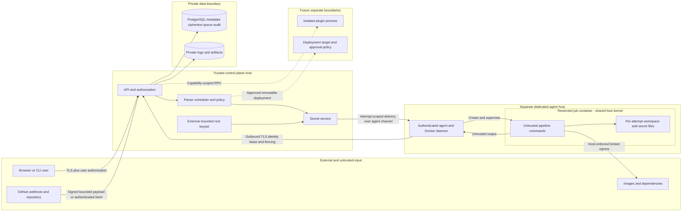

# Initial threat model

Status: proposed Phase 0, 2026-09-29. Owner: Shipra maintainer; review before the first execution release and after changes to trust boundaries. Controls below are design requirements, not implemented mitigations. The [security architecture](security.md) defines the supported v0.1 operating envelope.

## Assets, actors, and assumptions

Assets are source code; credentials and root keys; user/agent identities; run plans and policy; truthful execution history; artifacts and their provenance; control-plane/runner availability; and future deployment targets. Adversaries include an unauthenticated network client, a malicious repository contributor, a compromised dependency/image, an operator exceeding their role, a compromised agent, a malicious future extension, and an attacker with stolen backups or tokens.

Administrators of Shipra, its host, database, and approved GitHub repositories are trusted for initial operation. Their compromise is a recognized high-impact residual risk. v0.1 does not provide mutually hostile tenancy, fork PR execution, public-repository execution, production deployment, or a remote attestation mechanism. Only owned private repositories and dedicated agent hosts are supported. Even within that envelope, pipeline contents are hostile input.

## Trust boundaries

There is no job-to-database, job-to-root-key, job-to-control-plane, or job-to-Docker-socket permission. The agent is trusted to enforce container setup but is not trusted merely because its protocol response is authenticated. The container boundary cannot withstand every kernel/runtime exploit. Future plugins and deployment targets are shown to preserve architectural boundaries; neither exists in v0.1.

## STRIDE risk register

S = spoofing; T = tampering; R = repudiation; I = information disclosure; D = denial of service; E = elevation of privilege. Initial and residual severity are qualitative design estimates, not measured likelihood. “Gate” names the proof required before the relevant feature ships.

| ID / category | Threat and affected boundary | Initial | Proposed control and release gate | Residual risk |
|---|---|---|---|---|
| T01 S/T | Spoofed or replayed webhook schedules unauthorized work | High | HMAC on raw bounded body; connected repository/event/ref validation; durable delivery dedupe. Tests A01, A02. | Medium: valid signed events can contain malicious code; shared-secret theft permits forgery. |
| T02 T/E | Malicious repo/pipeline changes plan or runs host commands | Critical | Data-only bounded parser, immutable plan/SHA, strict schema, no control-plane execution, fixed executor profile. A03, A04. | High: authorized shell code remains arbitrary code inside the job. |
| T03 T/E | Event, ref, branch name, path, or user value becomes shell source | High | No textual interpolation of untrusted metadata into scripts; argument arrays/environment data; no shell-built Git/Docker commands. A04. | Medium: user-written shell scripts may intentionally misuse inputs. |
| T04 I/E | Job obtains another project's secrets or self-authorizes secret use | Critical | Administrator policy outside repository, exact project/ref/commit/plan checks, dispatch recheck, attempt-scoped fetch. A05. | High: legitimate recipient or trusted ref writer can reveal secrets it receives. |
| T05 I | Secrets leak through logs, diagnostics, artifacts, process lists, backups | Critical | No plaintext persisted plan/log spool; pre-storage masking; narrow runtime injection; encrypted secret store; authenticated data reads. A06, A07. | High: transformed/derived secrets and malicious artifacts cannot be fully filtered. |
| T06 S/T/E | Compromised runner impersonates another runner or alters another attempt | Critical | Revocable scoped identity, server grants, lease generation checks, per-attempt artifact/log authorization. A08. | High: an authorized malicious runner can falsify its own results and steal its own assigned secrets. |
| T07 E/I | Container escape, socket access, host mount, host network, or lateral movement | Critical | Dedicated hosts, no privileged flags/socket/host namespaces, hardened runtime, network boundaries, no prod secrets. A09, A10. | High: shared-kernel vulnerabilities and host compromise remain; stronger isolation needed for hostile tenancy. |
| T08 E/S | Stolen session/token, IDOR, role escalation, CSRF, or unsafe recovery | Critical | Server-side role checks on every object; opaque tokens with digest storage and expiry/revocation; secure session/CSRF; rate limits; admin bootstrap only. A11. | Medium: XSS or endpoint compromise can act as a user until detected/revoked. |
| T09 I/E | SSRF from checkout URLs, redirects, image fetches, callbacks, or plugin endpoints | Critical | Fixed provider endpoints, explicit admin destination policy, DNS/IP/redirect checks, independent network enforcement. A10. | Medium: allowed services may themselves proxy data; configuration errors weaken restrictions. |
| T10 T/I | Artifact poisoning, archive traversal, executable HTML, or cross-run overwrite | High | Immutable attempt namespace, server digest/size validation, safe paths/no extraction, inert downloads, provenance linkage. A12. | High: attacker controlling a build can produce harmful bytes with a correct digest. |
| T11 T/E | Compromised dependency/image or Shipra release updates trusted code | Critical | Lockfiles, pinned image digests where practicable, release SBOM/checksums/signatures, vulnerability review, isolated builds. A13. | High: signing establishes publisher identity, not benign behavior; scanners miss attacks. |
| T12 D | YAML expansion, excessive DAGs/logs/artifacts, fork bomb, disk fill, API flooding | High | Parser/request/graph caps, quotas, timeouts, cgroups, bounded spooling, rate limits, queue admission. A03, A09, A14. | Medium: shared resources and distributed denial of service still require host/network operations. |
| T13 T/R | Duplicate execution, stale completion, retry overwrites, or partitioned side effects | High | Durable attempt IDs, fencing, idempotent completion, fail-closed lease handling; no exactly-once claim. A08, A15. | High: already-issued shell/network side effects cannot be undone by fencing. |
| T14 R/T | Actor denies changing policy or deletes traces | High | Transactional audit events, actor/run/policy correlation, restricted append path, operational backups. A16. | Medium/High: database/host administrators can alter local audit; immutable external export is future work. |
| T15 E/T | Unauthorized deployment, approval bypass, stale approval, malicious rollback | Critical | No deployment engine/production credentials in v0.1. Future approval binds environment, artifact digest, plan, commit, actor and policy; target-scoped identity and fencing. A17 before deployments. | High: target compromise or authorized harmful deployment; rollback may itself fail or damage state. |
| T16 E/I/D | Plugin vulnerabilities, excessive capability, malicious update, or crash | Critical | No third-party plugin loading in v0.1. Future isolated RPC plus OS sandbox, explicit grants, quotas, deadlines, pinned packages. A18 before plugins. | High: process isolation alone cannot contain same-user code; approved capabilities can be abused. |
| T17 I/T | Root-key theft/loss, ciphertext transplant, backup restore with missing key | Critical | Vetted AEAD, identity-bound associated data, external versioned keyset, separate restricted key backup, rotation/restore drill. A07. | High: root-key plus ciphertext exposure reveals secrets; key loss destroys availability. |
| T18 T/E | Log/AI prompt injection induces privileged remediation | High | Logs are inert untrusted data; no execution from stdout; future AI proposals require independent user policy authorization. A19 before AI. | Medium: human reviewers may act on misleading output. |

GitHub's [self-hosted runner guidance](https://docs.github.com/en/actions/reference/security/secure-use) supports treating runner compromise and deliberate secret disclosure as residual risks. [Docker's daemon security guidance](https://docs.docker.com/engine/security/) motivates the separate agent-host boundary. The exact Shipra controls and release gates above are architectural proposals.

## Concrete abuse cases

1. A private-repository reader submits a fork PR that prints secrets. v0.1 rejects the event before creating runnable work; “private repository” alone is not a trust decision. Secret-bearing manual runs must also meet connected-repository/ref policy.
2. An operator triggers a harmless-looking feature branch that changes the secret list. The server checks administrator-managed project policy, denies unauthorized secrets, and produces a policy failure before assignment. Changing pipeline YAML cannot change a policy grant.
3. A job logs an authorized token in two output chunks, then base64-encodes it. Raw cross-chunk matching must redact the direct value. Encoded deliberate leakage is documented as not reliably preventable; restrict recipients/egress and rotate the token on exposure.
4. A revoked agent submits “success” and uploads an artifact after another attempt has started. The server rejects both mutations by agent identity and lease generation, while retaining the rejected-event audit. It cannot prove the old container stopped.
5. A pipeline image asks for a host mount or Docker socket. The schema/profile rejects the request; executor tests inspect actual runtime configuration, not just the parsed YAML. An image exploiting a kernel bug is still a residual risk.
6. A log contains HTML, terminal escape codes, or a message claiming “administrator approved deployment.” The UI renders it as inert text; no control action trusts stdout.
7. An attacker sends a valid authenticated API request for an artifact ID from an unauthorized scope or swaps a secret ciphertext row between projects. Authorization denies the first; AEAD associated-data verification rejects the second.
8. A malicious plugin asks for global secret enumeration when enabled for one notifier. Future capability negotiation rejects the package's grant expansion until a separate administrator decision. Its OS policy also blocks direct database/key-file access; RPC denial alone is insufficient.

## Required adversarial tests

All tests are planned work. Use synthetic secrets, isolated disposable hosts/networks, bounded load, and controlled fixtures. No exploit testing against third-party services. Automated tests must assert observable denial, state, audit, and cleanup behavior, not only function return values.

| Test | Required evidence | Gate |
|---|---|---|
| A01 | Provider test vector succeeds; wrong/missing signature, altered bytes, unsupported events, wrong repository, oversize and malformed bodies rejected | Webhook release |
| A02 | Concurrent duplicate deliveries create one accepted event/run; replay after restart still dedupes within configured retention; signed event never bypasses ref policy | Webhook release |
| A03 | Parser fuzzing with aliases, deep nesting, duplicate keys, unknown fields, huge graphs and invalid expressions; bounded time/memory, no dynamic evaluation | Parser before execution |
| A04 | Branch names, filenames and event fields containing shell metacharacters remain data; runtime launches use safe arguments; source-archive extraction rejects escaping paths/symlinks and excessive expansion; no control-plane extraction/script execution | Execution release |
| A05 | Cross-project secrets, unauthorized refs, manual-trigger bypass, revoked policy, stale plan, missing protection proof, retry retaining pinned versions, new-run rotation, and wrong-agent secret retrieval all tested | Before any real secret |
| A06 | Split/multiline secret chunks, reconnect/retry spool, crashes and UI output masking; raw bytes absent from persistent logs/traces; encoding limits explicitly demonstrated | Before any real secret |
| A07 | Tampered/transplanted ciphertext fails; missing key fails closed; rotate/read/rewrap/restart works; encrypted data plus separately restored key recovers; old-key retirement is checked | Before any real secret |
| A08 | Enrollment replay/race/expiry, token revocation, cross-agent claims, stale generations, duplicate and out-of-order logs/completion cannot change another attempt; same-session active claim replay issues only equivalent scoped grants, closed assignments never reopen | Agent release |
| A09 | Runtime inspection confirms no socket/host namespace/mount escalation; non-root/capability profile and CPU/RAM/PID/disk/time limits work; cleanup failure quarantines agent | First Docker execution |
| A10 | From control plane and container, test redirect, IPv4/IPv6, metadata, loopback/private network, DNS rebinding and host services against a controlled fixture; separate permitted provider traffic succeeds | First remote execution |
| A11 | Role-by-endpoint matrix, IDOR/log SSE/artifact download, CSRF, session fixation, token demotion/revocation, bootstrap reuse, and password rate limits | Auth foundation |
| A12 | Artifact path traversal, escaping symlink, special file, digest/length mismatch, duplicate finalization, wrong attempt, active HTML download and upload timeout | Artifact release |
| A13 | Dependency scan policy and SBOM produced; release signature/checksum failure blocks update; altered agent binary provenance rejected | Distributable release |
| A14 | Rate/request/queue/log/artifact caps under bounded load preserve admission control and clear errors; no unbounded raw log spool | v0.1 release |
| A15 | Crash/partition/restart during execution and finalization; stale mutations rejected and unknown outcomes surfaced; retry side-effect caveat visible | v0.1 release |
| A16 | Policy mutation cannot commit without audit; audit excludes secrets; actor/attempt/version correlation persists across retries; backup recovery preserves records | Auth and v0.1 release |
| A17 | Approval cannot be reused for another digest/environment/plan; approver role checked at use; rollback and cancellation retain target authorization; disconnect cannot silently redeploy | Future deployment release |
| A18 | Plugin timeout/crash, denied capabilities, malicious filesystem/network access, unsigned/digest-changed update, incompatible protocol and grant expansion | Future plugin release |
| A19 | Prompt-injected logs, artifacts, or model output cannot execute remediation or grant access without current independent authorization | Future AI release |

## Risk acceptance and changes

Critical gaps in authorization, credential handling, intended network isolation, parser containment, or attempt fencing block the relevant release. A failed control is not silently recategorized as an accepted residual risk. Supported v0.1 residual risks must be documented in the installation guide and reviewed by the instance owner: trusted contributors can misuse allowed secrets; a compromised agent can lie; containers share a kernel; and shell side effects are not exactly once.

Before supporting public/fork code, several workspaces with separate trust, production targets, shared caches, external plugins, Kubernetes, or AI, revise this model with new assets, boundaries, abuse cases, tests, and a recorded approval. Archive the previous model and associate the review with the architecture version.
